**PHP · Laravel · React · Next.js · WordPress**

## About me

Full Stack Web Developer from Lahore, Pakistan, with **4+ years** of experience building secure, scalable and high-performance web applications.

I design the architecture, write and review the code, and test every release. I use AI tools as development assistants to deliver faster and raise team productivity.

- 💼 Web Developer (AI-Assisted Development) at [Metaviz](https://metaviz.io/), April 2026 to present
- ⚡ Building with **PHP, Next.js and React**, plus **WordPress and WooCommerce** for client sites
- 🧱 Working on **Enlorix**, a multi-tenant website platform (Next.js, Cloudflare Workers, D1, Supabase)
- 🤖 AI-assisted workflow with **Claude, ChatGPT, Codex, Grok and Antigravity**
- 🎓 Certification in IT & Training, College of International Skills Development (CISD)

## Tech stack

**AI tools:**       

## Experience

**Web Developer (AI-Assisted Development), [Metaviz](https://metaviz.io/)** · April 2026 to present
- Build and ship PHP, Next.js and React web applications, client websites and platform features.
- Built the Media Manager (folder upload, in-browser resizing, trash with restore, bulk download, video streaming) and the Emails area (Outbox, Inbox, Compose with live preview, templates, form submissions) for Enlorix.
- Build WordPress and WooCommerce sites and own quality through end-to-end testing on live environments.

**Web Developer, [Maavra Technologies](http://www.maavratech.com/)** · May 2022 to April 2026
- Designed, built and maintained responsive websites, integrated front-end with back-end systems, and improved performance by optimizing queries, caching and assets.

## Featured projects

| Project | Stack | What it does |
| --- | --- | --- |
| **[Dealer eProcess](https://www.dealereprocess.com/)** (USA) | PHP, Laravel, React.js | Automotive dealership websites with SRP and VDP modules, payment gateways and scheduling integrations. |
| **[Laravel E-Commerce](https://github.com/shkarmish/my-laravel-project)** | Laravel, AJAX, MySQL | Product management with CRUD, AJAX search and pagination, cart and checkout. |
| **[Task Manager](https://github.com/shkarmish/task-manager-crud-project)** | Laravel 12, Tailwind CSS, MySQL | Secure auth with Laravel Breeze, user-isolated tasks, status tracking with color-coded badges. |
| **[Car Dealership Website](https://github.com/shkarmish/cars_website)** | PHP, MySQL, AJAX | Dynamic inventory with pagination, detail pages, form validation and duplicate prevention. |

## Let's connect

I am open to working with teams that value fast, clean and well-tested delivery.

📧 [shkarmish@gmail.com](mailto:shkarmish@gmail.com) · 🔗 [LinkedIn](https://www.linkedin.com/in/shkarmish/) · 🌐 [Portfolio](https://shkarmish-dev-m8mt20u.gamma.site/)

